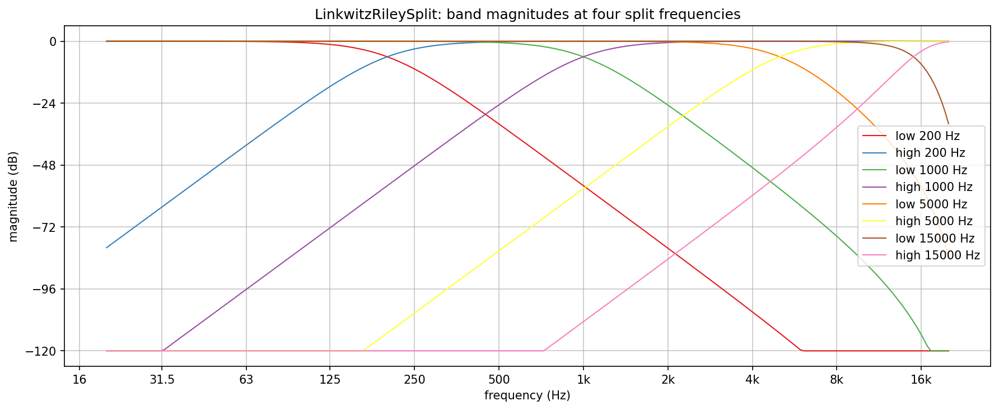
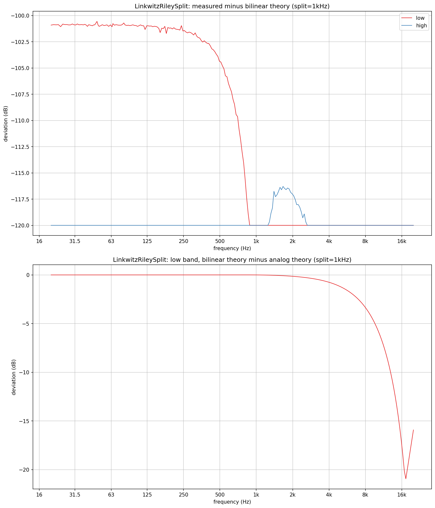
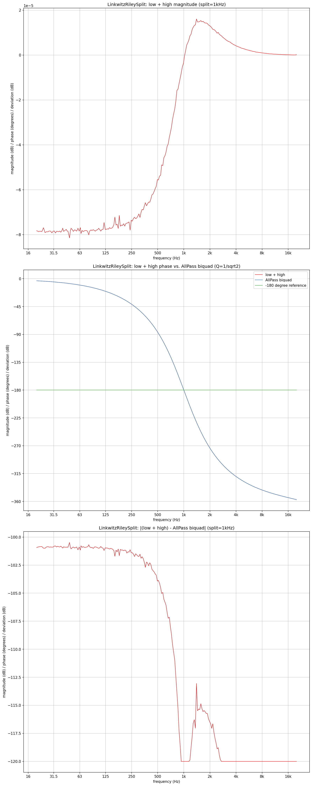

# LinkwitzRileySplit verification plots

Verifies `AbacDsp::LinkwitzRileySplit` (`src/includes/Filters/LinkwitzRileySplit.h`) with no JUCE involved: the
band magnitudes at four split frequencies, the deviation of the measured response from the closed-form digital
response, and the allpass behaviour of the sum of the two bands.

`lrs_bands.png`, `lrs_theory.png` and `lrs_sum.png` in this folder are checked-in samples, produced by
`./generate.sh` (configures and builds `LinkwitzRileySplitExplore` behind `EXPLORE_STUFF` into the gitignored
`build/` at the repo root, runs it, sets up a local `.venv` from `requirements.txt` and renders the PNGs; the
intermediate `PyConPlot.py` text goes into the gitignored `generated/`).

## Design in one paragraph

Each band is two cascaded Butterworth biquads (Q = 1/sqrt(2)) at the same frequency: the low band is `LowPass`
twice, the high band `HighPass` twice, so both are -6 dB at the split frequency and in phase there. The sum
`low + high` is not the input but a 2nd-order allpass of it (flat magnitude, phase lagging from 0 to -360 degrees,
exactly -180 degrees at the split frequency); `low + high == in` is not a property of a Linkwitz-Riley split.
Same filter as `Graph::Nodes::CrossoverLR4` (see `../CrossoverLR4/`), with a per-sample `step()` returning both bands.

## Theory used for the check

The 2nd-order Butterworth lowpass has |H|^2 = 1 / (1 + w^4); squaring the magnitude of the cascade gives
|LP| = 1 / (1 + w^4) and |HP| = w^4 / (1 + w^4). For the analog filter w = f / fc. `Biquad` uses the bilinear
transform, so the digital filter has the same shape in the warped frequency
w = tan(pi f / fs) / tan(pi fc / fs), and that is the reference the measurement is compared with.

Reference: S. H. Linkwitz, "Active crossover networks for noncoincident drivers", JAES 24(1), 1976, 2-8;
https://en.wikipedia.org/wiki/Linkwitz%E2%80%93Riley_filter

## How the data is measured

Every point is measured by driving the split sample by sample with a settled sine and correlating each output with
exp(-j*phase) over exactly one second (an integer number of cycles at whole-Hz frequencies), which gives the
complex gain of the low band, the high band and their sum in one pass. A reference `AllPass` biquad runs through
the identical measurement.

## What the plots show

**Band magnitudes** at 200 Hz, 1 kHz, 5 kHz and 15 kHz. Each pair crosses at -6 dB at its split frequency; the low
band falls and the high band rises at 24 dB/octave (one grid step of 24 dB per octave along the diagonal). Far from
the split the rejection reaches the plot floor of -120 dB. Near Nyquist the low band of the 15 kHz split bends
down faster than 24 dB/octave: bilinear warping, see below.

**Deviation from theory** (top): the difference between the measured band magnitudes and the bilinear closed form,
as a linear difference in dB. It stays at about -100 dB or below, which is float precision, so the implementation
is the filter described above and not a look-alike. **Warping** (bottom): the bilinear response minus the analog
response of the low band at a 1 kHz split. Up to 2 kHz the difference is under 0.3 dB; at 8 kHz it is about -3 dB and
it grows towards Nyquist. A split frequency near the top of the range therefore has a steeper stopband than the
analog textbook curve; the passband and the -6 dB crossing are unaffected, since the warping is pre-compensated at
the split frequency.

**Sum**: the top subplot is the magnitude of `low + high`; the axis scale is 1e-5 dB, so it is flat to float
rounding. The middle subplot is the phase, lagging from 0 toward -360 degrees and crossing the -180 degree reference
at 1 kHz; the `AllPass` biquad's curve lies exactly under it, so only one line is visible. The bottom subplot is the
difference between the two in dB: -100 dB or below, again float precision.

## Limits

The frequency is clamped to [10 Hz, 0.45 * sample rate]. Changing it replaces the coefficients at once and keeps
the filter states, so a jump while a signal is present can click; a caller that sweeps it sets it in small steps.
