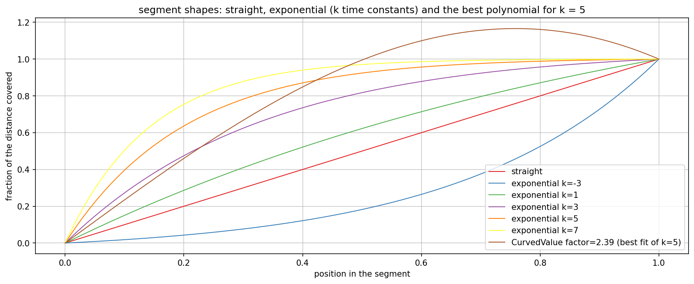
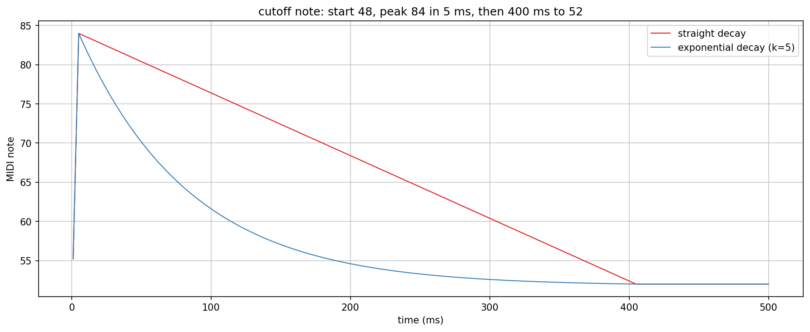

# Envelope segment shapes

Checks the segment shapes of `AbacDsp::Envelope` (`src/includes/Generators/AdsEnvelope.h`): the polynomial
`CurvedValue` that every segment has always had, and `ExponentialApproach`, selected per segment with
`SegmentShape::Exponential`. The unit tests are in `test/Generators/AdsEnvelope_test.cpp`.

`envelope_shapes.png` and `envelope_pitch.png` in this folder are checked-in samples of the plots below.

## Quick start

`./generate.sh` runs `EnvelopeCurveExplore.cpp` through `dev-scripts/dev-explore.sh`, writes the plot data into a
gitignored `generated/` folder, sets up a local `.venv` from `requirements.txt` and renders both PNGs with
`documentation/Plot/PyConPlot.py`. By hand, from the repo root:

```bash
EXPLORE_OUT_DIR=$PWD/documentation/Generators/generated \
    ./dev-scripts/dev-explore.sh documentation/Generators/EnvelopeCurveExplore.cpp
```

The program is also a target (`EnvelopeCurveExplore`) behind the `EXPLORE_STUFF` CMake option.

## Choosing a shape

A segment takes a `curve` value and a `SegmentShape`. Without the shape (the default, `Polynomial`) nothing changes
for existing code: `curve` is the factor of `CurvedValue`, 0 is a straight line.

```cpp
Envelope<3> env{48000.f};
env.setSegment(0, 5.f, 84.f, 0.f);                                     // straight attack
env.setSegment(1, 400.f, 52.f, 5.f, SegmentShape::Exponential);        // exponential decay, 5 time constants
env.setSegmentHoldPreviousValue(2, 0.f);
env.markSustainAt(2);
env.triggerFrom(48.f);                                                 // jumps to 48, then runs the chain
```

With `SegmentShape::Exponential` the `curve` value is `k`, the number of time constants that fit in the segment, and the
shape is

    s(x) = (1 - exp(-k x)) / (1 - exp(-k)),   x = t / segment length, 0 <= x <= 1

so the segment lands on its target exactly at its end, whatever `k` is. `k` = 0 is a straight line, a negative `k`
mirrors the curve (slow start, fast end) and `k` is limited to -50..50. Segment values are plain numbers, so an
envelope can carry a gain, a MIDI note or a cutoff.

## The shapes



The exponential curves cover the distance fast at the start and slowly at the end: after a quarter of the segment k = 3
has covered 55 % of the distance, k = 5 72 % and k = 7 83 %. The brown curve is the best `CurvedValue` for k = 5
(factor 2.39, searched from -3 to 3): it follows the shape only in the first part and then overshoots the target by
17 % before it comes back. The table has the best polynomial factor for each k and its largest distance to the
exponential, as a fraction of the segment:

| k | best factor | largest error | highest value |
|---|---|---|---|
| 1 | 0.60 | 0.021 | 1.000 |
| 2 | 1.16 | 0.055 | 1.004 |
| 3 | 1.65 | 0.096 | 1.052 |
| 5 | 2.39 | 0.183 | 1.166 |
| 7 | 2.89 | 0.260 | 1.254 |
| 10 | 3.00 (limit of the search) | 0.380 | 1.275 |

The polynomial stands in for an exponential up to about k = 1. Beyond that its error grows and it passes the target,
which is why the exponential is its own shape and not a factor of `CurvedValue`.

## An envelope in notes



`Envelope<3>` in MIDI notes at 48 kHz: `triggerFrom(48)`, a 5 ms straight attack to note 84, a 400 ms decay to note 52
that stays there. The red curve decays straight, the blue one with k = 5. Against the closed form, the exponential
decay deviates by at most 0.00065 notes (the span is 32 notes).
`triggerFrom` jumps to the start value, so a second trigger starts again at 48, not at the note the first one reached.

The exponential costs one `expm1` per sample while such a segment runs; the polynomial costs a few multiplications.
