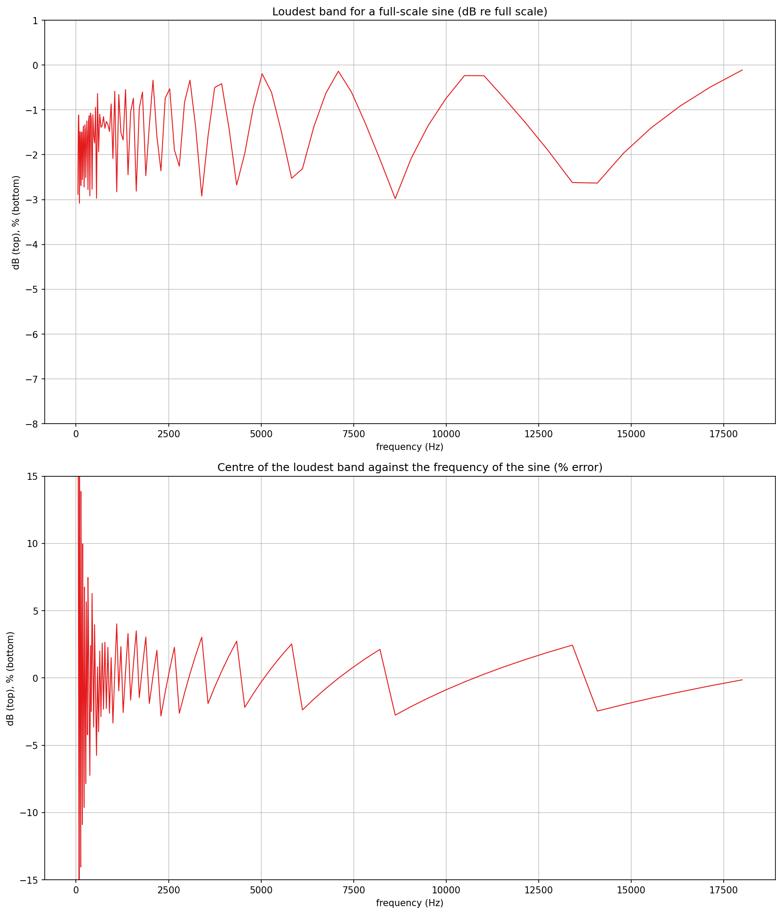
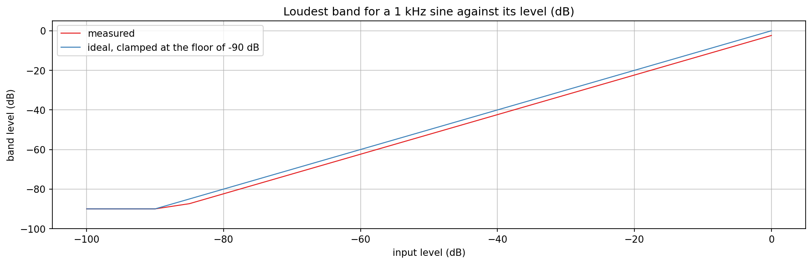
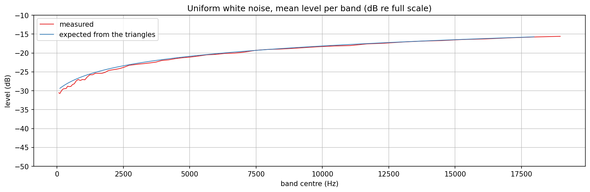

# MelColumns verification plots

Checks `src/includes/Analysis/MelColumns.h` directly, with no JUCE involved: the level of a tone against its frequency,
the dB scale against the amplitude, and the level of white noise per band against the area of the triangles. The class
turns the frames of the STFT of `SpectrogramBase` into columns of mel bands with levels from 0 to 1, for a running
spectrogram.

## Quick start

`./generate.sh` runs the whole pipeline in one step: configures and builds `MelColumnsExplore` (behind `EXPLORE_STUFF`,
into a gitignored `build/` at the repo root), runs it, sets up a local `.venv` from `requirements.txt`, and renders the
three PNGs in this folder. The intermediate `PyConPlot.py` text goes into a gitignored `generated/` subfolder. The
program prints the figures quoted below.

## What the class does

Each frame is a Hann-windowed FFT of 2048 samples with a hop of 512 (a column every 10.7 ms at 48 kHz). The 64 bands
are triangles of peak 1 on the mel scale, 30 Hz to 20 kHz, with centres equally spaced in mel. A band is the square root
of the sum over its bins of weight times power, so a tone has the same level wherever it lies. The Hann window spreads a
sine over 1.5 bins of noise bandwidth, which is divided out, and the level is in dB re a full-scale sine centred on a
bin. The range -90 to 0 dB maps linearly onto 0 to 1.

At 48 kHz the bins are 23.4 Hz apart, so the lowest bands, 10 to 20 Hz wide, are narrower than a bin. A band without a
bin near its centre takes the nearest one with weight 1, so that no band stays dark.

## What the charts show

### Level of a tone against its frequency (`mc_tone.png`)

A full-scale sine from 50 Hz to 18 kHz in 120 logarithmic steps, ten frames each, last column.

- The loudest band is within 0.1 to 3.1 dB of full scale (3.08 dB at the worst). The dips are the tones that fall
  between two band centres: the power of a tone is shared by the two overlapping triangles, so at the midpoint each has
  half, which is 3 dB. A tone on a band centre is at 0 dB.
- The centre of the loudest band is within 4 % of the tone from 1 kHz up, where the bands are 5 % apart. At 300 Hz they
  are 14 % apart and at 100 Hz 33 %, and the error reaches half of that.

### Level scale (`mc_linearity.png`)

A 1 kHz sine from -100 to 0 dB in steps of 5. The measured line is the ideal line, clamped at the floor of -90 dB,
shifted by 2.4 dB at most: 1 kHz is not on a band centre, which costs a constant offset between 0 and 3 dB. The step of
20 dB in input is 20 dB in the column value within 0.01 of the scale (the unit test checks this).

### White noise per band (`mc_noise.png`)

Uniform white noise, mean of 400 columns. A band sums the bins under its triangle, so the level of noise rises with the
bandwidth of the band, about 3 dB per octave above 5 kHz. The expected line is computed from the area of each
triangle in bins; it is within 0.44 dB of the measurement for every band wider than 8 bins. Below that the bands
take whole bins and the measured level is up to 2 dB under the line, because the triangle samples a handful of bins.

## References

- Mel scale: <https://en.wikipedia.org/wiki/Mel_scale>
- Window function, equivalent noise bandwidth of the Hann window: <https://en.wikipedia.org/wiki/Window_function>

Both are in `WEB-REFERENCES.md`.
