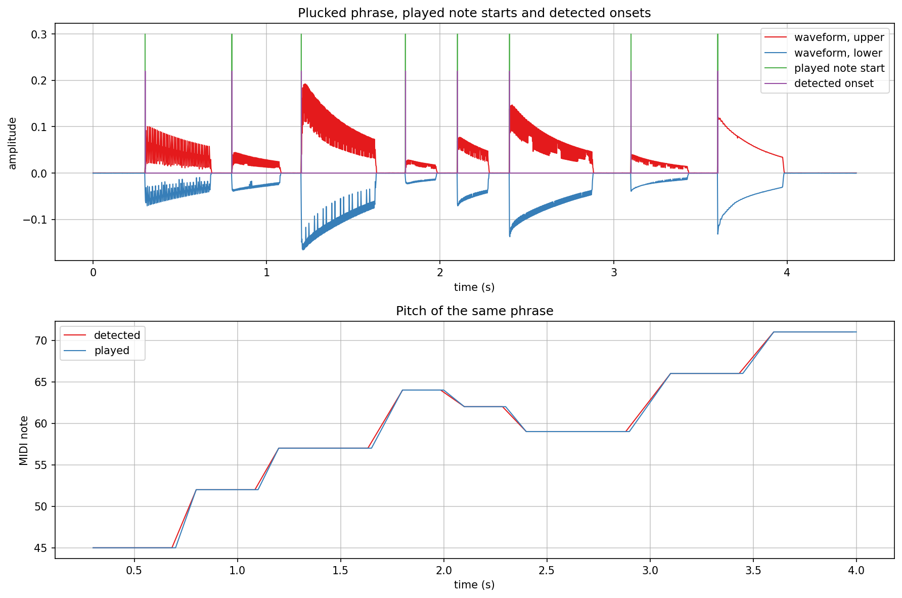
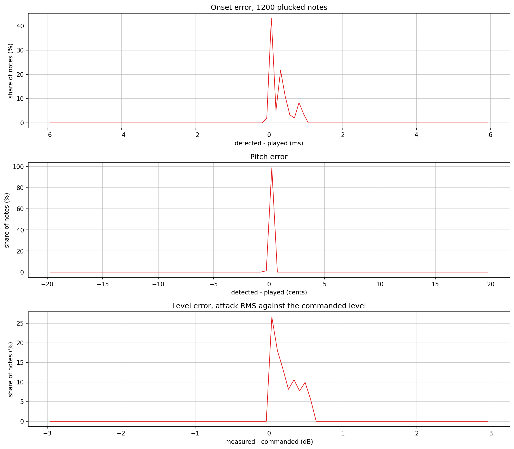
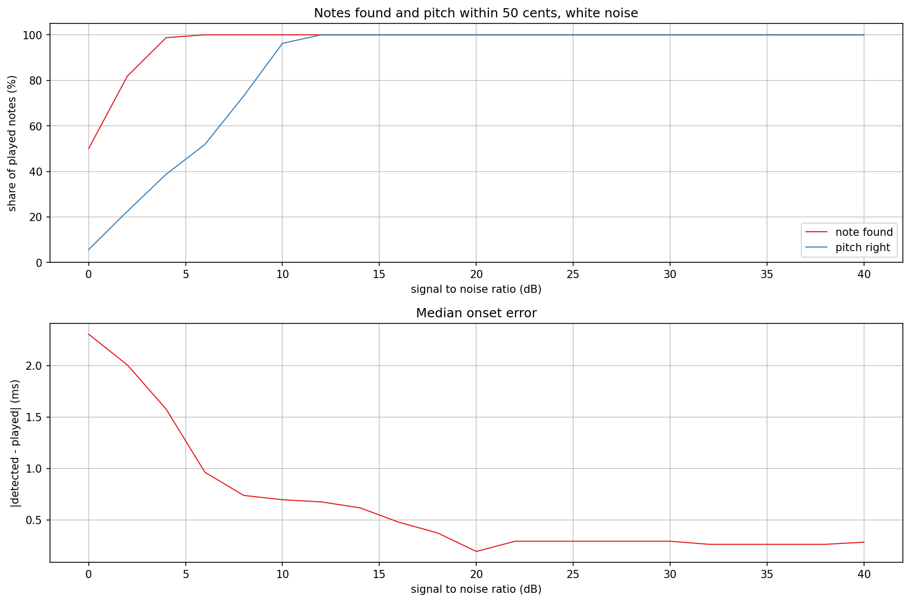
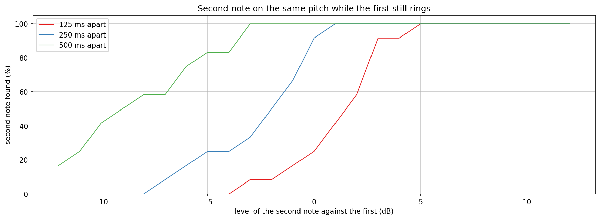
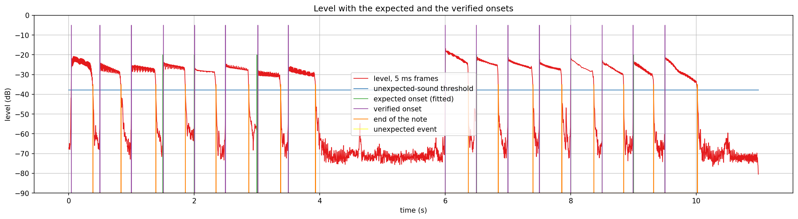
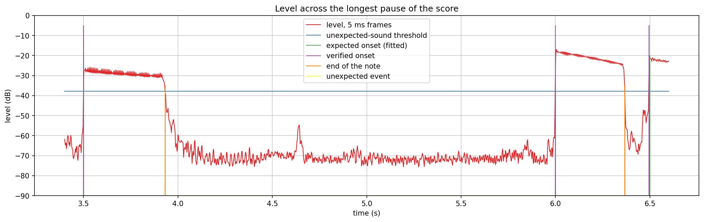
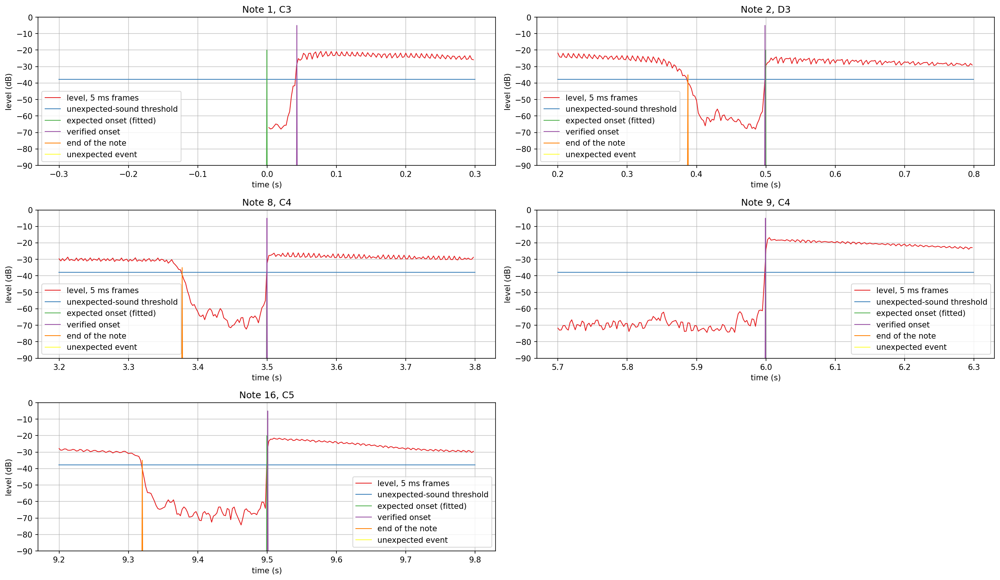

# NoteSegmenter and NoteVerifier verification plots

Two offline analysers for a monophonic recording live in `src/includes/Analysis/`. `NoteSegmenter`
finds the notes blindly. `NoteVerifier` checks a recording against the notes that should have been
played, which is what an exercise knows; its section starts at "Verifying a recording against a
score" below.

The first part checks `NoteSegmenter`. For every note it reports the onset, the offset, the pitch
as a fractional MIDI note, the peak level and the RMS level of the first 100 ms.

How it works, in short:

- The level is measured in 5 ms frames every 2.5 ms. The gate sits 10 dB above the quietest 2 % of
  the frames, never below -66 dB.
- An onset is a frame that rises 6 dB above the lowest frame of the previous 32 ms, while above the
  gate. After an onset the detector waits for the level to peak, so a slow attack is one onset.
- The coarse frame is then refined on the waveform: starting from the quietest frame in front of
  the onset, the onset is the first sample where the signal has covered a tenth of the way from the
  level before it to its peak. That makes it independent of how loud the previous note still rings.
- A note ends 20 dB below its peak, under the gate, or where the next note starts.
- Pitch is the median of YIN estimates (50 per second) from 40 ms after the onset to the end of the
  note. A pitch that moves to another semitone for 60 ms and stays there splits the note, with
  hysteresis so that vibrato does not.

`generate.sh` builds `NoteSegmenterExplore.cpp`, runs it, and renders every PNG here. Intermediate
data goes into the gitignored `generated/`. A full run takes about ten minutes, most of it the
level reference renders of the error plot. The notes are rendered with `KarplusStrongVoice`
(guitar-like settings, four voices in rotation) and each one is damped 25 ms before its end,
which leaves the dip in front of a repeated note that the detector needs.

## What the plots show

One phrase of eight plucked notes at different pitches (45 to 71) and levels (0 to -18 dB). The
detected onsets coincide with the played note starts and the detected pitch follows the played
pitch. Quiet notes (the fourth and the seventh, -18 and -15 dB) are found as reliably as loud ones,
because the onset rule is relative to the level in front of the note, not absolute. The detected
offset lies up to some 20 ms before the played end: the string is damped 25 ms before its end and
the offset is the point where the note has fallen 20 dB below its peak.

Error distributions over 150 takes of 8 random notes each: pitch 40 to 84, level 0 to -30 dB,
spacing 250 to 600 ms, length 50 to 100 % of the spacing. All 1200 notes are found, with no
missed note and no extra one. The onset lies 0 to +1 ms after the moment the string was plucked
(median 0.28 ms): the detector reports the point where the attack has reached a tenth of its peak,
not the first non-zero sample, which is a fixed, small and level-independent delay. The pitch is
within 0.5 cents of the played pitch for all notes, as expected for a clean periodic signal and
YIN with parabolic interpolation. The level error compares the measured attack RMS with the
commanded level, relative to the same pitch played alone at 0 dB. It lies between 0 and +0.6 dB,
a small bias from the longer window of the reference note, so differences between notes are
accurate to well under 1 dB.

White noise added to eight 0 dB notes (first-100-ms RMS about -24 dB) per take. Every note is
still found down to 6 dB signal to noise ratio, and about 99 % at 4 dB. The pitch stays right for
every note down to 12 dB, falls to 73 % at 8 dB and is unreliable below that: the YIN estimate
needs a clearly periodic signal. The median onset error stays under 1 ms down to 8 dB and grows to
2.3 ms at 0 dB. This is white noise; a real room adds low-frequency rumble that hurts the pitch
earlier on the low strings.

The limit of the onset rule. The second note has the same pitch as the first and the first is not
damped, so there is no dip in front of the attack. The detector sees only a rise of the overall
level, and the rise must be 6 dB over the lowest frame of the previous 32 ms. 500 ms after the
first note the second one is found at 100 % when it is at most 3 dB softer and still at half
when 9 dB softer. At 250 ms it must be as loud as the first, at 125 ms about 3 to 5
dB louder. A sustained instrument with a quiet articulation dip, or a plucked one that is damped
between notes, does not have this problem; a ringing guitar playing fast repeated notes at equal
level does. The remedy would be a spectral-flux onset function next to the level rise; it is not
built yet.

## Run time

Offline on one core (release build): 11.9 s of audio with a 60 Hz lowest pitch takes 0.85 s, 10.1
s with a 35 Hz lowest pitch (bass) takes 2.1 s. Nearly all of it is the YIN estimate, whose cost
grows with the square of the analysis window, so the lowest expected pitch should come from the
instrument's range. This runs on a worker thread after the take, never on the audio thread.

## Verifying a recording against a score

Real guitar (`guitar-samples/`, one C major scale from C3 and one from C4, quarter notes at 120
BPM, played to a click, each note stopped with a pause of about 130 ms before the next) shows the
limit of finding notes blindly. The 16 real notes are all found with the right pitch, but
`NoteSegmenter` returns 36 detections: five notes are found twice (a loud 40 ms event right in
front of the note, at the same level), 13 are quiet sounds 25 to 40 dB under the notes that lie
30 to 130 ms before an onset (a pre-sound of the pluck or the fretting hand), and two lie in the
empty bar and after the last note. A program that knows the score does not need to explain any of
them: they are either part of the note or too weak to matter.

`NoteVerifier` takes the expected notes (time and MIDI pitch) and looks for each one in its own
window:

- The window reaches at most half the distance to the neighbouring notes and `windowSeconds`
  (0.45 beat here) either side of the expected time.
- A common timing offset is fitted first, so a player who is consistently late is not marked
  late on every note. The offset comes from the strongest level rises against the score, then
  from the median onset error.
- In the window the strongest level rise is the note. Its onset is the first moment the level comes
  within 12 dB of the note's peak, refined on the waveform like in `NoteSegmenter`. A sound further
  under the peak, such as a pre-sound, does not count; a louder double onset is one note that
  starts at the first rise.
- The pitch is the median of YIN estimates within one octave of the expected pitch, 40 ms after the
  onset. A wrong note or an octave error is measured and reported, not forced to the expected
  pitch. The verdict is right, sharp or flat (more than 25 cents), wrong note (more than 50 cents),
  no pitch or missing.
- Anything outside the notes that stays 15 dB under the median note level or louder for at least
  50 ms is reported as unexpected sound with time, level and pitch. Weaker sound is noise; the
  report gives the loudest of it and its margin to the threshold, so a player can see the noise
  (string slides, release thumps) shrink before it ever reaches the threshold.

### Result on the guitar recording

All 16 notes are found and right. Onsets lie within 15 ms of the grid after the common offset of
0 ms, except the first note, which starts 43 ms late. Pitch errors are between -8 and +3 cents.
No unexpected sound reaches the threshold of -37.8 dB (15 dB under the median note level of
-22.8 dB). The loudest ignored sound is a bump at 0.855 s, 20 ms after the second note was
stopped, at -42.9 dB: 5.0 dB under the threshold. The next one is a pre-sound in front of the
thirteenth note, 9 dB under. All other pauses keep 13 dB or more.

| Note | want | onset error (ms) | pitch error (cents) | peak (dB) |
|---|---|---|---|---|
| 1 | C3 | +43 | -6 | -20.7 |
| 2 | D3 | -1 | +3 | -24.2 |
| 3 | E3 | 0 | +1 | -25.4 |
| 4 | F3 | +10 | 0 | -23.8 |
| 5 | G3 | +7 | -6 | -26.8 |
| 6 | A3 | -1 | -4 | -24.7 |
| 7 | B3 | +15 | -2 | -27.9 |
| 8 | C4 | 0 | +1 | -25.9 |
| 9 | C4 | 0 | +2 | -16.8 |
| 10 | D4 | -4 | -8 | -21.1 |
| 11 | E4 | 0 | -3 | -21.4 |
| 12 | F4 | 0 | +2 | -22.4 |
| 13 | G4 | -1 | -1 | -21.7 |
| 14 | A4 | 0 | 0 | -22.8 |
| 15 | B4 | -8 | +1 | -23.1 |
| 16 | C5 | +1 | +2 | -21.5 |

The level of the whole recording in 5 ms frames. Every verified onset (purple) lies on the expected
onset (green), the note ends (orange) where the level falls under the threshold (blue) after the
string is stopped, and nothing reaches the threshold outside the notes.

The empty bar between the two scales. The level falls to a noise floor around -70 dB, 30 dB under
the threshold, with one blip near 4.64 s at about -55 dB that stays well below it.

The window around five notes: the first two, the two on either side of the long pause, and the
last. The pause between two notes shows the quiet level before each onset, which rises over 20
to 40 ms from about -65 dB. This is the pre-sound; it stays under the band around the note's
peak, so the onset is the real attack. The first note starts 43 ms after the score: the level
climbs from -67 dB to -42 dB over 20 ms and then jumps to -25 dB, and the onset is the jump.

### Limits

- The strongest rise in a window is the note. A louder sound inside a window competes with it, so
  an extra pluck close to an expected note is not told apart from it.
- A note that is not 6 dB louder than the ringing of the previous one is missed, as in
  `NoteSegmenter`.
- At least one note must be found to have a reference level for the threshold.
- The unexpected-sound threshold and the 12 dB band are first guesses from one guitar, one player
  and one microphone. The other instruments and a voice will move them; both are configuration.
- Tested on constructed signals (`test/Analysis/NoteVerifier_test.cpp`) for the wrong, missing and
  extra note, the real recording has none of these.

### Adding a recording

The recordings are not committed. The guitar take lies in `guitar-samples/` at the repository root;
a new one goes in its own folder per instrument. Each has a score file in `scores/`: `bpm <value>`
and one `note <MIDI note> <beat from bar 1> <length in beats>` line per note, `#` starts a comment.

`generate_verifier.sh [recording.wav] [score file]` builds `NoteVerifierExplore`, prints the table
above for the recording, writes the plot data to the gitignored `generated/` and renders the three
PNGs here. The defaults are the guitar take and `scores/guitar_c_major_scale.score`.
