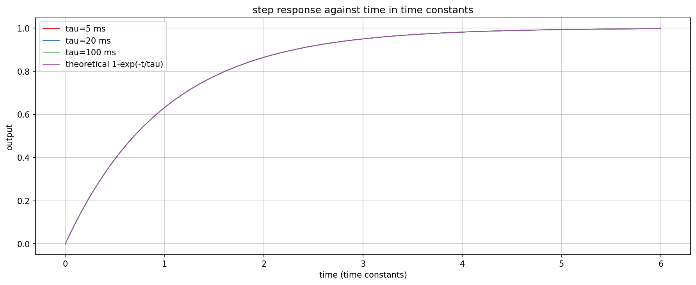
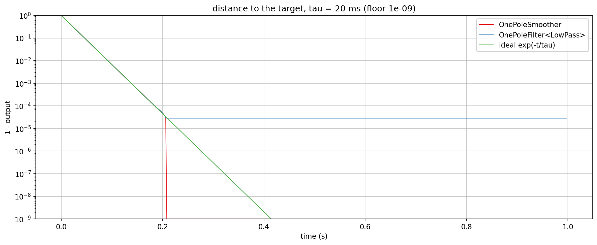

# OnePoleSmoother checks

Checks `AbacDsp::OnePoleSmoother` (`src/includes/Parameters/OnePoleSmoother.h`) against the theory of a one-pole
smoother, `y[n] = t + (y[n-1] - t) c` with `c = exp(-1 / (tau fs))`, and against `OnePoleFilter<LowPass>`
(`src/includes/Filters/OnePoleFilter.h`), whose recursion it shares.

`smoother_step.png` and `smoother_stall.png` in this folder are checked-in samples of the plots below.

## Quick start

`./generate.sh` runs `OnePoleSmootherExplore.cpp` through `dev-scripts/dev-explore.sh`, writes the plot data into a
gitignored `generated/` folder, sets up a local `.venv` from `requirements.txt` and renders both PNGs with
`documentation/Plot/PyConPlot.py`. By hand, from the repo root:

```bash
EXPLORE_OUT_DIR=$PWD/documentation/Parameters/generated \
    ./dev-scripts/dev-explore.sh documentation/Parameters/OnePoleSmootherExplore.cpp
```

The program is also a target (`OnePoleSmootherExplore`) behind the `EXPLORE_STUFF` CMake option.

## Step response



A step from 0 to 1 at 48 kHz for `tau` = 5, 20 and 100 ms, drawn against time in units of `tau`. All three curves lie
on `1 - exp(-t / tau)`: 63.2 % after one time constant, 86.5 % after two, 99.8 % after six. The time constant is
independent of the sample rate because the coefficient is computed from `tau * fs`; the unit tests check 44.1, 48 and
96 kHz.

## Reaching the target



The same step with `tau` = 20 ms over one second, as the distance `1 - y` on a logarithmic axis. Both follow the ideal
exponential until the distance is about 3e-5. There the float update `t + (y - t) c` no longer changes `y`
(`ulp / (2 (1 - c))`), and `OnePoleFilter<LowPass>` stays at that distance for ever. The smoother snaps to the target
when a step changes nothing or the distance is below `kSnapDistance`, so `isSettled()` becomes true and a decay
towards 0 does not end in denormals. The axis is floored at 1e-9, which is where the smoother's curve ends.
