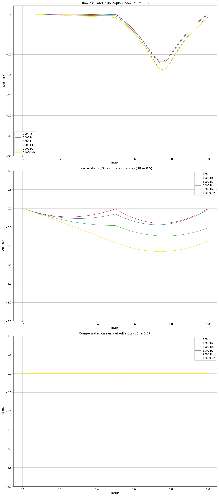
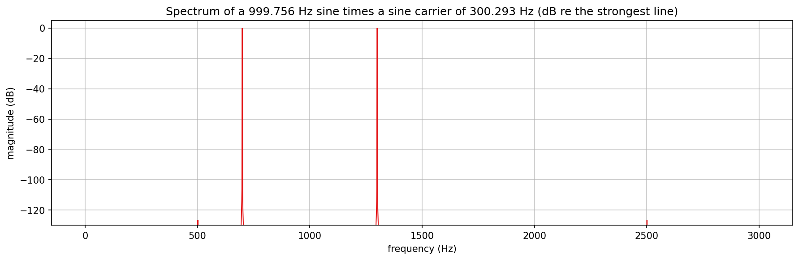
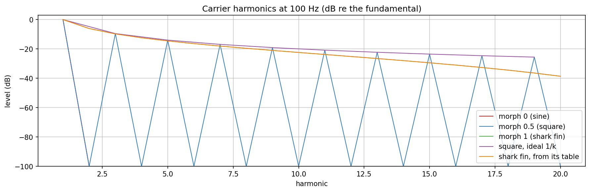
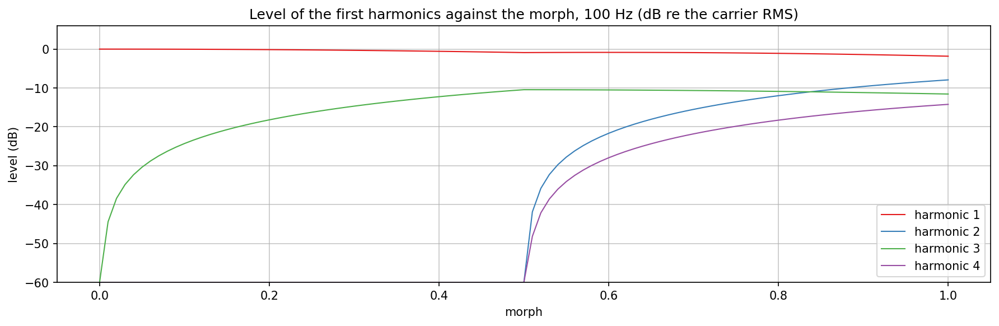
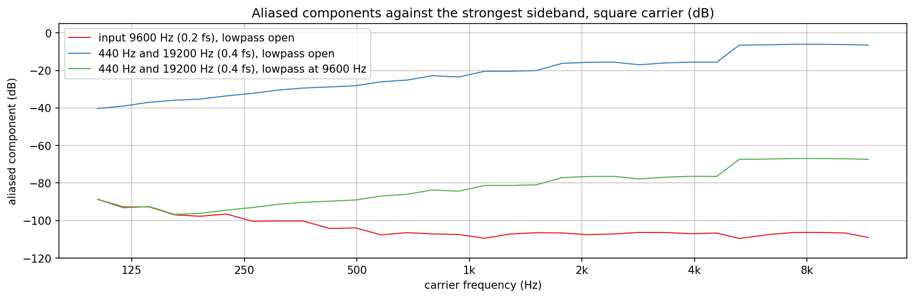
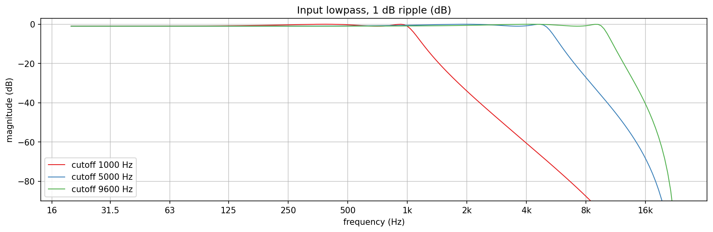

# WaveTableRingModulator verification plots

Checks `src/includes/Modulation/WaveTableRingModulator.h` and the classes it stands on
(`Wavetables/MorphCarrierLevel.h`, `Filters/Chebyshev4Lowpass.h`, `Filters/RampedBiquad.h`) directly, with no JUCE
involved: the level of the carrier against morph and pitch, the sideband lines, the carrier harmonics against theory,
how the harmonics move with the morph, aliasing with the input lowpass open and closed, and the response of that
lowpass. The class is a ring modulator whose carrier is `WaveTableOscillator` over three slots, held at a constant RMS.

## Quick start

`./generate.sh` runs the whole pipeline in one step: configures and builds `WaveTableRingModulatorExplore` (behind
`EXPLORE_STUFF`, into a gitignored `build/` at the repo root), runs it, sets up a local `.venv` from
`requirements.txt`, and renders the six PNGs in this folder. The intermediate `PyConPlot.py` text goes into a
gitignored `generated/` subfolder. The program prints the figures quoted below.

## What the charts show

### Level against morph and pitch (`wr_level.png`)

RMS of the carrier over one second at 100, 1000, 3000, 6000, 9000 and 11000 Hz, morph 0 to 1 in steps of 0.02.
The top two panels are the bare `WaveTableOscillator` in dB re its table level 0.5, the bottom panel the class in dB
re its carrier RMS (0.57).

- The oscillator is not level. Higher mip levels have fewer harmonics, so the level falls with pitch (a square from
  6 kHz up is 0.9 dB down), and a crossfade of two correlated waves dips in the middle.
- With the slots Sine, Square, Saw the second half of the morph has a deep dip: 11.7 dB at 100 Hz and 13.8 dB from
  3 kHz up, at a morph of 0.75. See "Why the third slot is a shark fin".
- With Sine, Square, SharkFin the dip is at most 0.39 dB at 100 Hz and 1.14 dB from 6 kHz up.
- The compensated carrier is within 0.001 dB of 0.57 at every point of the grid. `MorphCarrierLevel` computes the RMS
  of the table the oscillator reads exactly, from three means per slot pair and mip level (the two mean squares and the
  cross term), so the compensation has no morph steps to interpolate.

A carrier at exactly 0.25 of the sample rate (12 kHz) is the one place where the compensation falls short: the 2nd
harmonic of the table sits on Nyquist, where the samples of the output are all zero, and the output is 0.83 dB below its
target at some morphs. At 11990 Hz the deviation is below 0.001 dB again.

### Sideband lines (`wr_sidebands.png`)

A sine of 999.756 Hz (bin 1365 of 65536 at 48 kHz) times the sine carrier of 300.293 Hz (bin 410), Hann window, whole
cycles. The product has its two lines at 699.46 and 1300.05 Hz; the input line at 999.756 Hz is gone, which is what
separates ring modulation from amplitude modulation. Every bin more than 30 Hz from the two lines is at least 126.7 dB
below them (single precision arithmetic).

### Carrier harmonics against theory (`wr_harmonics.png`)

Harmonics 1 to 20 at 100 Hz over 20 whole cycles, in dB re the fundamental. Morph 0 is a sine (every other harmonic
below the -100 dB floor of the plot). Morph 0.5 is the square: the odd harmonics follow 1/k within 0.004 dB, the even
ones are below -100 dB. Morph 1 is the shark fin: its harmonics equal those of its own table within 0.002 dB (a falling
saw with a 4 % rise has no closed form as simple as 1/k).

### Harmonics against the morph (`wr_morph_harmonics.png`)

The level of harmonics 1 to 4 of the compensated carrier at 100 Hz against the morph, in dB re the carrier RMS. The
fundamental stays within 1.83 dB of the RMS over the whole morph; the 3rd harmonic grows from the sine to the square, the
even harmonics enter past 0.5 and grow towards the shark fin.

### Aliasing against the carrier frequency (`wr_aliasing.png`)

The carrier is band-limited by the mip levels (no harmonic folds; at exactly 0.25 of the sample rate the 2nd harmonic sits
on Nyquist), the product is not: a sideband above Nyquist folds back. The chart measures, for a square carrier from 101 to 11900 Hz, the largest
component more than 40 bins (29 Hz of a 65536-point Hann FFT) from every line |f +/- h fc| inside the band, h up to the
harmonics the carrier has, in dB re the strongest line. A carrier frequency whose period is nearly a whole number of
samples lets the folded components land on genuine lines, so such frequencies are moved off (see the program).

- A sine at 0.2 of the sample rate (9600 Hz), lowpass open: at most -88.7 dB. 0.2 + 0.3 = 0.5, so nothing folds; what
  remains is the arithmetic of the table and the 32 bit FFT.
- A 440 Hz tone with a 19200 Hz (0.4 fs) partial a quarter its size, lowpass open: -40 dB at 101 Hz rising to -6 dB above
  5 kHz. A bright partial against a square carrier aliases, as the arithmetic says it must.
- The same input with the input lowpass at 9600 Hz: -97 to -67 dB, 48 to 61 dB below the open case at every carrier
  frequency of the grid.

### The input lowpass (`wr_prefilter.png`)

`Chebyshev4Lowpass` at 1 dB ripple and cutoffs of 1000, 5000 and 9600 Hz: 4th order, 24 dB per octave, the ripple band
ends at the cutoff. The tests measure the closed-form error of the design at 0.041 dB at most from 60 Hz to 0.45 fs, a
cutoff sweep on a chord with the coefficient ramps at 1.07 times the largest step of the steady chord (3.2 times
without the ramps), and a bit-exact bypass when the cutoff is open.

## Against the sine ring modulator

At morph 0 with its default slots the class equals `RingModulator` scaled by carrierRms / 0.7071: over one second of a
317 Hz sine of amplitude 0.5 against a 1234.5 Hz carrier the largest difference is 4.1e-4 (the linear interpolation of
the 2048-point table; unit test `aSineCarrierEqualsTheSineRingModulatorScaledByItsRms`).

## Why the third slot is a shark fin

The tables of the store come out of an FFT synthesis with the wave upside down (a sine reads as -sin, the saw falls); the
class applies a negative gain so that the waves have their textbook polarity. Textbook, a rising saw has its fundamental
in antiphase with a square that starts positive: their correlation is -0.87
(the mean of their product, -0.5, over the RMS of the saw, 1 / sqrt(3)). A crossfade from the square to the saw then
cancels the fundamental near a morph of 0.75 (RMS down by 11.8 dB at 100 Hz, the fundamental at 0.007 of its normal
level), and the compensation, which holds the RMS, lifts what is left: a stack of harmonics 2 and up. `SharkFin`, the
store's falling saw with a short rise, is bright like a saw with its fundamental in phase with the square's, and the
morph has no null. The slots can be changed with `setWaveset()`; the combinations measured at 100 Hz:

| Slots | Worst RMS dip | Weakest fundamental (of its normal level) |
| --- | --- | --- |
| Sine, Square, Saw | -11.8 dB | 0.007 |
| Sine, Square, SharkFin | -0.4 dB | 0.81 |
| Sine, Triangle, Saw | -3.0 dB | 0.61 |
| Sine, Triangle, Square | -3.0 dB | 0.67 |

The test `aSawNextToASquareNullsTheFundamentalAndASharkFinDoesNot` in `test/Wavetables/MorphCarrierLevel_test.cpp` keeps
the first two rows.

## References

- Ring modulation: <https://en.wikipedia.org/wiki/Ring_modulation>
- Wavetable oscillator with mip levels: <https://www.earlevel.com/main/2012/05/04/a-wavetable-oscillator-part-1/>
  (snapshot: <https://web.archive.org/web/20260418094159/https://www.earlevel.com/main/2012/05/04/a-wavetable-oscillator-part-1/>)
- Chebyshev filter: <https://en.wikipedia.org/wiki/Chebyshev_filter>

All three are in `WEB-REFERENCES.md`.
