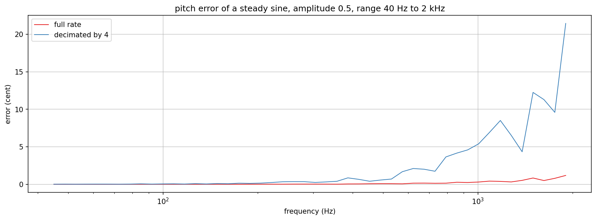
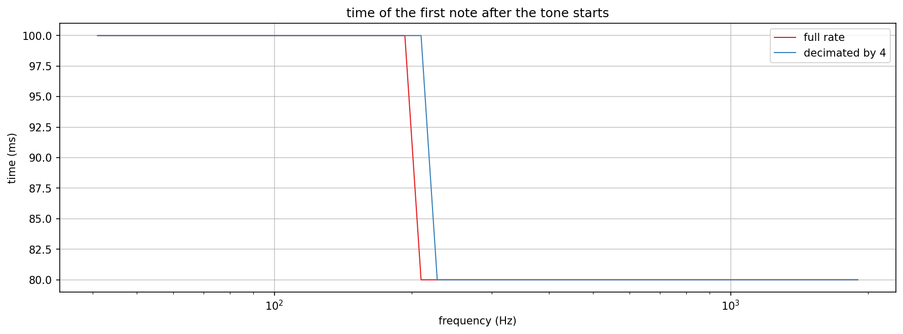
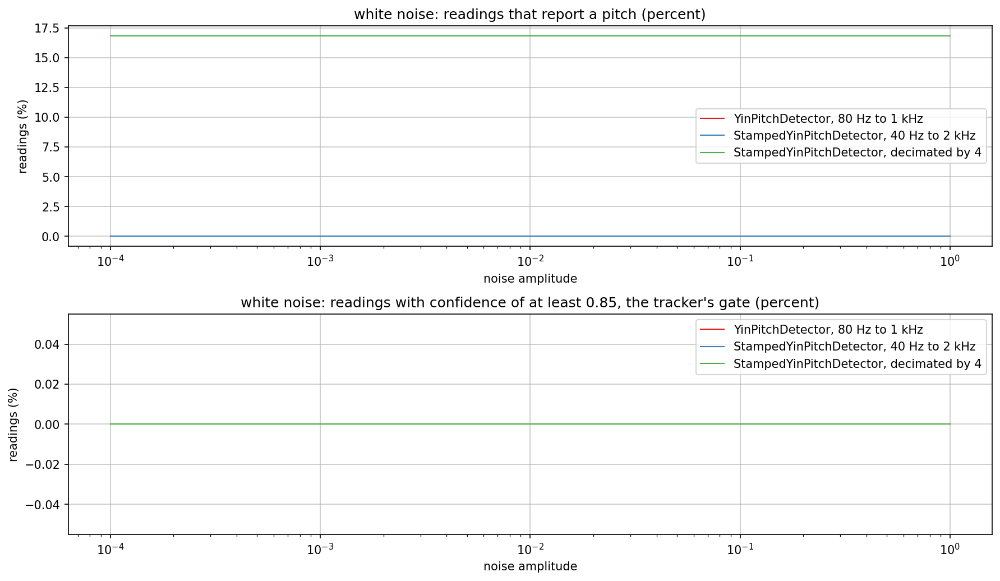
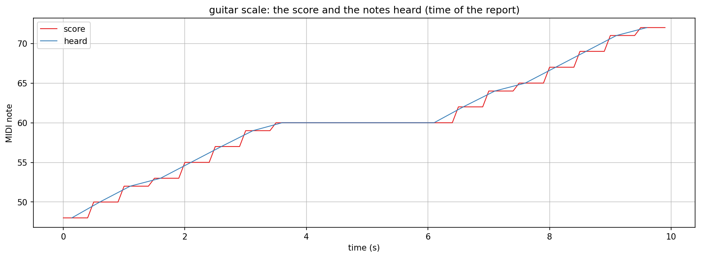

# YIN pitch detection and note tracking

Checks `StampedYinPitchDetector` (`src/includes/Analysis/StampedYinPitchDetector.h`) and `PitchNoteTracker`
(`src/includes/Analysis/PitchNoteTracker.h`) from 40 Hz to 2 kHz, and `YinPitchDetector`
(`src/includes/Analysis/YinPitchDetector.h`) on quiet noise. The `yin_*.png` files in this folder are checked-in samples of the
plots below.

## Two detectors, and why both exist

`YinPitchDetector` and `StampedYinPitchDetector` are the same algorithm (the cumulative mean normalised difference function, an
absolute threshold of 0.1, parabolic interpolation) for different jobs.

| | `YinPitchDetector` | `StampedYinPitchDetector` |
|---|---|---|
| Window | four periods of the lowest frequency, the first half integrated | 2 * maxLag samples |
| Lags computed | every lag, every hop | lag by lag, stopping at the first dip below the threshold |
| Cost control | none | integer decimation, cost falls with its square |
| Per reading | pitch and confidence | pitch, confidence, level and the count of input samples consumed |
| Reset | none | `reset()` |
| Used by | `NoteSegmenter`, `NoteVerifier`, `PitchFadeWindowDelay` | `PitchNoteTracker` through a stream of readings |

The first is used by analysis and effects with thresholds tuned to its window; the second exists because turning readings into
note events needs a level and a time stamp with every reading, a bounded cost on a small CPU, and a low range. `PitchNoteTracker`
is the streaming counterpart of `NoteSegmenter`: it takes one reading at a time and reports a note after three steady readings, a
release after three unvoiced ones, and a new strike when the level rises by 6 dB.

## Quick start

`./generate.sh` runs `StampedYinExplore.cpp` through `dev-scripts/dev-explore.sh`, writes the plot data into a gitignored
`generated/` folder, sets up a local `.venv` from `requirements.txt` and renders the PNGs with `documentation/Plot/PyConPlot.py`.
`GUITAR_WAV=<recording.wav> ./generate.sh` adds the guitar plot (`StampedYinGuitarExplore.cpp`; the score is
`documentation/NoteSegmenter/scores/guitar_c_major_scale.score`, the recording is not in the repository). Both programs are
targets behind `EXPLORE_STUFF` too. By hand, from the repo root:

```bash
EXPLORE_OUT_DIR=$PWD/documentation/YinPitch/generated \
    ./dev-scripts/dev-explore.sh documentation/YinPitch/StampedYinExplore.cpp
```

## Pitch error over the range



A sine of amplitude 0.5 read after one second, detector range 40 Hz to 2 kHz, hop 50 Hz, at 48 kHz. At full rate the error is
below 0.1 cent up to 500 Hz, 0.3 cent at 1 kHz and 1.2 cent at 1.9 kHz. Decimated by 4 it is 0.9 cent up to 500 Hz, 5.4 cent at
1 kHz and 21 cent at 1.9 kHz, where a period is six samples of the decimated rate. The arithmetic falls with the square of the
decimation, and the tracker accepts readings within 50 cent of each other, so the note number is still right (see the tests).

## Time to the first note



The tone starts at sample 0; the time is the stamp of the reading that completed the note, the end of the analysis window of the
third steady reading. Above about 200 Hz it is 80 ms; the window of a 40 Hz range is 50 ms long, so tones below about 200 Hz
need one more reading and are reported at 100 ms (41.2 Hz, E1, is note 28; 82.4 Hz, E2, note 40). The step is the hop of 20 ms;
the full rate and the decimated detector differ only at the edge of it.

## Noise



White noise of amplitude 1e-4 to 1, 96000 samples per point. `YinPitchDetector` and `StampedYinPitchDetector` at full rate
report a pitch on none of the readings at any level. Decimated by 4, the lowpass in front makes noise look slightly periodic and
16.8 percent of the readings carry a pitch, at every level; their confidence stays below 0.85, so none passes the gate of
`PitchNoteTracker` (lower plot) and the tracker never reports a note from noise (the chain tests run the five tones and six noise
levels at both settings).

Before the cumulative sum of `YinPitchDetector` started at lag 1 (it started at `d(0) = 1`, a constant that dominates for quiet
signals), the upper plot's red line was at 100 percent for noise of amplitude 0.01 and below: every reading was a pitch. The
test `QuietNoiseIsNotReadAsPitched` fails before that fix (95 of 95 readings) and passes after it.

## A guitar recording



The recording of a guitar scale (C3 to C4, then C4 to C5, quarter notes at 120 BPM) through the decimated detector and the
tracker: all 16 notes are heard with the right note number and nothing else is reported, 80 to 140 ms after the expected onset
(the first note is played 43 ms late, see the `NoteVerifier` section). The blue line joins the times of the reports. There is no
annotated bass recording in the repository; the 41.2 Hz tone of the tests stands in for a low E.
